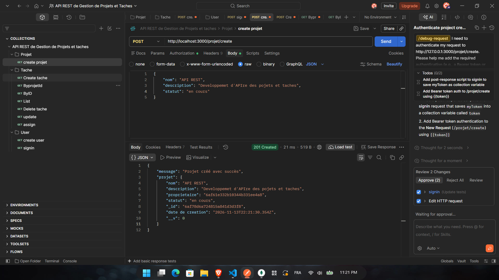
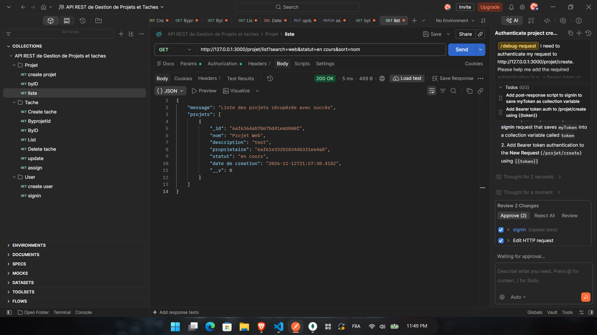
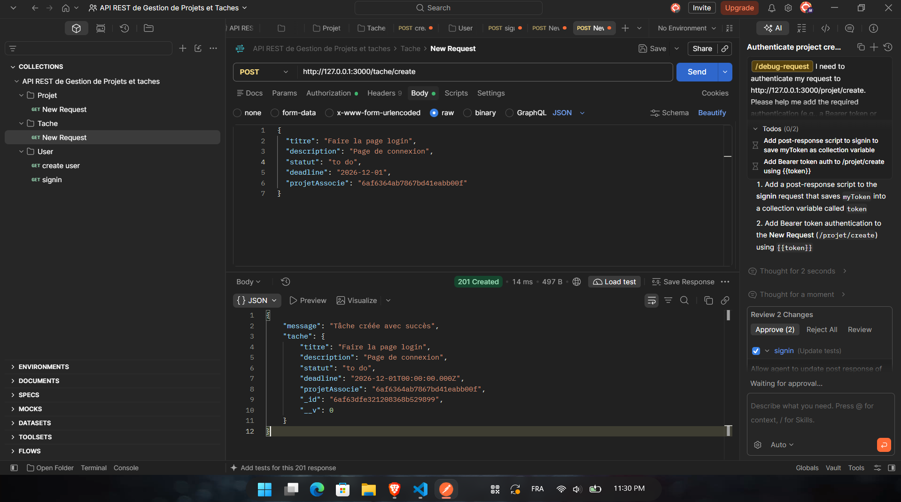

# API REST de Gestion de Projets et Tâches

> **DS1 - Mini-Projet - ISIDS**
> API REST sécurisée (Express.js + MongoDB) permettant à des utilisateurs authentifiés de gérer leurs projets et les tâches associées.

---

## 👥 Auteurs

| Nom et prénom | GitHub |
|---|---|
| **Khalil Chaffar** | [@Khalilchaffar03](https://github.com/Khalilchaffar03) |
| **Mohamed Ali Basti** | [[@pseudo-github]](https://github.com/dali77777) |

---

## 📌 Fonctionnalités

- **Authentification JWT** avec deux rôles : `user` et `manager`
- **Gestion des projets** : création, consultation, modification, suppression
- **Gestion des tâches** rattachées à un projet
- **Affectation d'une tâche** à un utilisateur (réservée au manager)
- **Recherche, filtre et tri** sur les projets et les tâches
- **Mots de passe hachés** avec bcrypt (jamais stockés en clair)
- **Middlewares** de protection des routes (token + rôle)

## 🛠️ Technologies

| Technologie | Rôle |
|---|---|
| Node.js + Express 5 | Serveur et routes |
| MongoDB + Mongoose | Base de données et modèles |
| jsonwebtoken | Authentification par token JWT |
| bcrypt | Hachage des mots de passe |
| dotenv | Variables d'environnement |

---

## 📁 Structure du projet

```
├── capturesProjet/     # Captures des tests Postman
├── config/             # Connexion à MongoDB
├── controllers/        # Logique métier (user, projet, tache)
├── middlewares/        # auth.js (token) et role.js (rôle manager)
├── models/             # Schémas Mongoose (user, projet, tache)
├── routes/             # Définition des endpoints
├── server.js           # Point d'entrée de l'application
└── Readme.md
```

Architecture : `routes → middlewares → controllers → models`

---

## 🚀 Installation et lancement

```bash
# 1. Cloner le dépôt
git clone https://github.com/Khalilchaffar03/Gestion-des-projets-et-taches.git
cd Gestion-des-projets-et-taches

# 2. Installer les dépendances
npm install

# 3. Créer le fichier .env (voir section suivante)

# 4. Lancer le serveur
node server.js
```

Le serveur démarre sur `http://127.0.0.1:3000`.

### Variables d'environnement (`.env`)

| Variable | Description |
|---|---|
| `SECRET_KEY` | Clé secrète utilisée pour signer les tokens JWT |
| `LOGIN` | Login du compte manager créé automatiquement au démarrage |
| `PASS` | Mot de passe de ce compte manager |

> ⚠️ Le fichier `.env` n'est pas versionné (voir `.gitignore`).

---

## 🔐 Authentification

1. Créer un compte : `POST /user/createuser`
2. Se connecter : `POST /user/signin`, la réponse contient un **token**
3. Envoyer ce token dans chaque requête protégée :

```
Authorization: Bearer <token>
```

## 🧑‍💼 Rôles et règles métier

| Règle | Implémentation |
|---|---|
| Tout utilisateur authentifié peut créer un projet | middleware `verifyToken` |
| Un `user` ne voit que **ses propres projets** | filtre sur `proprietaire` |
| Seul le **manager** voit tous les projets | contrôle du rôle dans `list` et `ById` |
| Seul le propriétaire (ou le manager) modifie/supprime un projet | `403` sinon |
| Tout utilisateur peut créer une tâche dans un projet existant | `POST /tache/create` |
| Statut d'une tâche limité à `todo`, `doing`, `done` | `enum` Mongoose |
| Seul le **manager** peut affecter une tâche à un utilisateur | middleware `verifyRole` |
| Un `user` accède à une tâche s'il est propriétaire du projet ou s'il en est assigné | fonction `peutAcceder` |
| La suppression d'un projet supprime aussi ses tâches | `Tache.deleteMany` |

---

## 🗃️ Modèles de données

**Utilisateur** : `nom`, `login`, `mot de passe` (crypté), `role` (`user` | `manager`), `date de creation`

**Projet** : `nom` (requis), `description`, `proprietaire` (ID utilisateur), `statut` (`en cours` | `terminé` | `en pause`), `date de creation`

**Tâche** : `titre` (requis), `description`, `statut` (`todo` | `doing` | `done`), `deadline`, `projetAssocie` (ID projet), `utilisateurAssocie` (ID utilisateur assigné), `date de creation`

---

## 📡 Endpoints

### Utilisateurs `/user`

| Méthode | Route | Accès | Description |
|---|---|---|---|
| POST | `/user/createuser` | Public | Créer un compte |
| POST | `/user/signin` | Public | Se connecter (retourne le token) |
| GET | `/user/list` | Manager | Liste des utilisateurs |
| GET | `/user/byid/:id` | Connecté | Un utilisateur par id |
| PUT | `/user/update/:id` | Connecté | Modifier un utilisateur |
| DELETE | `/user/delete/:id` | Manager | Supprimer un utilisateur |

### Projets `/projet` (token obligatoire)

| Méthode | Route | Accès | Description |
|---|---|---|---|
| POST | `/projet/create` | Connecté | Créer un projet |
| GET | `/projet/list` | Connecté | `user` : ses projets / `manager` : tous |
| GET | `/projet/byid/:id` | Propriétaire / Manager | Détail d'un projet |
| PUT | `/projet/update/:id` | Propriétaire / Manager | Modifier un projet |
| DELETE | `/projet/delete/:id` | Propriétaire / Manager | Supprimer un projet et ses tâches |

### Tâches `/tache` (token obligatoire)

| Méthode | Route | Accès | Description |
|---|---|---|---|
| POST | `/tache/create` | Connecté | Créer une tâche |
| GET | `/tache/list` | Connecté | Tâches accessibles à l'utilisateur |
| GET | `/tache/byid/:id` | Autorisé | Détail d'une tâche |
| GET | `/tache/byprojet/:projetId` | Propriétaire / Manager | Tâches d'un projet |
| PUT | `/tache/update/:id` | Autorisé | Modifier une tâche |
| PATCH | `/tache/assign/:id` | **Manager** | Affecter une tâche à un utilisateur |
| DELETE | `/tache/delete/:id` | Autorisé | Supprimer une tâche |

---

## 🔎 Recherche, filtre et tri

### Projets
```
GET /projet/list?search=web&statut=en cours&sort=nom
```

| Paramètre | Effet |
|---|---|
| `search` | Recherche partielle dans le nom (insensible à la casse) |
| `statut` | Filtre par statut (`en cours`, `terminé`, `en pause`) |
| `sort` | Tri (`nom`, `-nom` pour décroissant). Par défaut : plus récents d'abord |

### Tâches
```
GET /tache/list?search=login&statut=todo&sort=deadline
```

| Paramètre | Effet |
|---|---|
| `search` | Recherche partielle dans le titre |
| `statut` | Filtre par statut (`todo`, `doing`, `done`) |
| `sort` | `deadline` ou `titre` |

---

## 📬 Exemples de requêtes

**Créer un projet**
```http
POST /projet/create
Authorization: Bearer <token>
Content-Type: application/json

{
  "nom": "Projet Web",
  "description": "Site de gestion",
  "statut": "en cours"
}
```

**Créer une tâche**
```http
POST /tache/create
Authorization: Bearer <token>
Content-Type: application/json

{
  "titre": "Faire la page login",
  "statut": "todo",
  "deadline": "2026-12-01",
  "projetAssocie": "<id du projet>"
}
```

**Affecter une tâche (manager)**
```http
PATCH /tache/assign/<id de la tâche>
Authorization: Bearer <token du manager>
Content-Type: application/json

{ "userId": "<id de l'utilisateur>" }
```

## 📊 Codes HTTP utilisés

| Code | Signification |
|---|---|
| `200` | Succès |
| `201` | Ressource créée |
| `400` | Données invalides |
| `401` | Non authentifié (token manquant ou invalide) |
| `403` | Authentifié mais accès interdit (rôle ou propriétaire) |
| `404` | Ressource introuvable |
| `500` | Erreur serveur |

---

## 🧪 Tests Postman

Toutes les routes ont été testées avec Postman. Les captures sont dans le dossier [`capturesProjet`](./capturesProjet).

### Création d'un projet


### Liste des projets (recherche + filtre + tri)


### Modification d'un projet


### Tâches d'un projet


---

## 🌿 Gestion de version

- Workflow par **branches** (`feature/...`) fusionnées dans `main`
- Commits courts et explicites (`feat:`, `fix:`, `docs:`, `refactor:`)
- Code commenté en arabe dialectal (darija)
